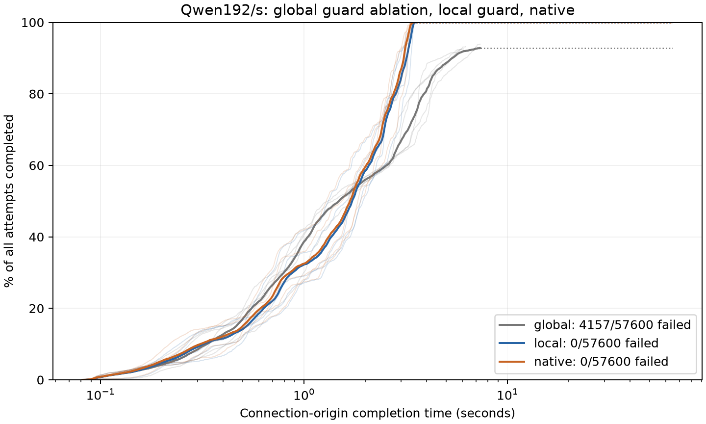

# Connection reclamation: complete matched result

Completed2026-10-16 UTC, original lab RTX5090 and g10 client.
All15 ordinary process cells/five blocks finish, with172800 measured attempts,
168643 successes,4157 failures and10793152 delivered tokens, plus120 excluded
checked warmups. All4157 failures are global-guard read timeouts without a
token. Local/native each deliver57600/57600. No measurement is replaced.

## Matched delivery and cost

Means of five process statistics; nominal paired t95df4. Global is a component
ablation with the same reference bookkeeping/ABI and pending-before-head order,
not an unchanged2c0cf7b implementation. Native is the main efficient C++ epoll
baseline with the same GPU model executor, weights, prompts, gen64, slots16
and NODELAY. Official vLLM whole-service reference is finding0069.

| Condition | Failed/57600 | Successful tokens/s | CompletionP99 ms | Client token-gapP99 ms | Group CPU ms/attempt | Host active CPU s/attempt | Device J/attempt |
|---|---:|---:|---:|---:|---:|---:|---:|
|Global guard ablation|4157|7793.075|5782.966*|8.456*|4.746725|0.079874|1.958086|
|Local guard candidate|0|11623.043|3410.279|3.856|1.695749|0.057707|1.707071|
|Efficient native|0|11642.741|3313.846|3.691|0.732280|0.056916|1.700772|

*Global latency quantiles condition on success and censor7.217% missing
completions. They are not all-attemptP99 or completed60-second responses.
All-attempt throughput/cost includes failures and terminal drain.

Primary local-minus-global failed-attempt fraction is
-0.072170[-0.082610,-0.061731], i.e.-7.217 percentage points.
Five global failure counts961/853/780/861/702; local/native all0.
Local-minus-global delivered throughput +3829.968[3550.624,4109.313]token/s,
conditional completionP99 -2372.687[-3273.355,-1472.019]ms, token-gapP99
-4.599979[-4.666285,-4.533674]ms, group CPU
-3.050975[-3.351076,-2.750874]ms/attempt. This repairs a real serving failure,
not model-compute throughput optimization.

The main local-minus-native comparison remains adverse:
throughput -19.698[-28.806,-10.589]token/s;
completionP99 +96.433[44.854,148.012]ms;
client token-gapP99 +0.165253[0.075087,0.255418]ms;
group CPU +0.963470[0.863478,1.063461]ms/attempt.
Whole-host active CPU +0.000791[0.000195,0.001387]s/attempt is observational;
device energy +0.006299[-0.003749,0.016348]J/attempt is inconclusive.
Do not claim eBPF speed/CPU superiority or equivalence. Zero observed
local/native failure has a degenerate blockwise difference interval[0,0],
which does not bound a rare failure probability or establish equivalence.

All16 paired effects, every per-cell P50/P95/P99, TTFT, TPOT, zero gaps,
scheduled-origin tails, lag, errors, and resource numerators are in
[raw/replay](verified_reclaim_full/) and [analysis](reclaim_analysis.py).
The raw failure_censored flag indicates the presence of failed requests;
statistical censoring applies to success-only tails, not to failure fraction,
throughput or all-attempt resource numerators.

Faint block curves and pooled empirical curves retain missing completion mass.
Failures never become completed60s samples.

## Cause and implementation contract

The [initial diagnostic](errno-result.md) observes2947 owned CLOSE_WAIT with
queued173, then insertion failures and first errno7E2BIG. Earlier untouched
finding0071 reaches4096 connections and exhibits the same failure class.
The corrected preflight has global499 insertion failures/timeouts versus
local0 and max_connections4096 versus309. Full final counter/connection/drain
receipts are retained per cell. A first errno is not an error distribution.

The global guard waits for unrelated backlog before reclaiming an EOF
connection. The candidate appends16KiB conservative peer pending buckets to
the existing shared page, with no new BPF map. Producer counts before queue
publication and rolls back failed push; sole consumer publishes slot/head
before decrement. GPU acquires its pending count before fresh head/seen check.
Collisions can defer reclaim but cannot permit early reclaim. Local guard
applies only to actual receive EOF; non-EOF dead/reset paths remain conservative.
Source model dispatcher SASS is unchanged; only network lifetime logic differs.

[Correctly built qualification](qualification.md) passes default8 two-model
protocol, dual replay, cancellation and the105-request collision/port-reuse
trajectory. At actual observed EOF, own pending0 and unrelated global40
remain. cuBLAS/cuFFT generic cases also pass. Static local/global GPU network
resource usage remains48registers/168stack bytes, model dispatcher40registers;
this is not dynamic cycle/energy attribution. Actual16-slot ctl value is38208
bytes, rounded40960 for mapping, memlock45056; the appended field adds16384
bytes without changing earlier offsets. Rebuild all ABI-dependent objects.

This evidence supports a bounded reclamation/capacity repair. It does not
allocate the old unreproduced6.36ms tail gap, prove RST-flood reliability,
arbitrary backend stability or general eBPF superiority.

## Observable resources and fidelity

Group/cgroup/host are nested views, never summed. io-wq belongs to the actual
server TGID and is already in group CPU. Thread/idle/observer ledger is
[details.stdout](verified_reclaim_full/details.stdout). Finite thread census
cannot attribute every kernel instruction. Whole-host includes other tenants
and control/observer work; device energy is whole device. Actual brackets
include exec/control and terminal drain, with startup/capture/shutdown outside
the steady-serving cost scope. Idle loaded device power is not an exclusive
GPU queue cost or off-model baseline; utilization100% is not SM saturation.

All successes have valid shape/vocabulary/protocol, but frozen finite output
set disagreements remain: global373, local638, native344, total1355/168643.
No observed-output expansion or universal numerical-parity claim. The targeted
corrected collision trajectory independently dual-replays6153 tokens exactly
despite9 finite-set disagreements; that validates its trajectory, not every
full-run output or the earlier failed trace-less case.

## Deviations, lifecycle, replay and review

[Build deviation](build-deviation.md) retains the missed nvcc -dc source
selection and withdraws invalid candidate acceptance. All affected checks and
comparisons repeated using explicitly corrected source/include commands.
The initial finite-membership failure and earlier old-guard traced success
remain; the latter blocking EOF read did not prove local reclamation.

[Collection notes](collection-notes.md) preserve two postmeasurement API exec
stdout resets. Both original client cells/observer/server terminals complete;
the same raw files were recovered, never measured again. Original order
resumes after completed receipts. The longer gaps and shared-host/device
exposure remain. Chunked deterministic gzip transfer changes collection only,
after observer stop. Measured-client gzip/transfer occurs after observation but
before server SIGTERM; warmup gzip precedes idle. Heavy resource/archive
compression occurs after server stop. This timing does not prove zero
interference with subsequent cells. No foreign
workload or original Coder session is interrupted.

All15 servers exit0 with owned pins removed. The temporary client Job and Pod
are deleted after review data recovery/source acceptance; [cleanup](cleanup.md)
and [runtime receipt](post_source_runtime_receipt.json) preserve actual checks.
The finite [host observation](host-observation.md) does not explain API resets.
Primary durable-archive CPU replay and both default8 protocol CPU replays are
byte-identical. Reader-only gzip shims preserve acquisition analyzers separately.
No benchmark outcome or metric was modified.

[Independent result review](result-review.md) is complete: valid run, supported
bounded repair, supporting research value and mechanism/workload boundary.
All cell metrics and16 paired intervals independently recompute exactly. The
collection-timing prose correction is resolved. Canonical integration is
recorded separately; no additional scientific rerun is required.
