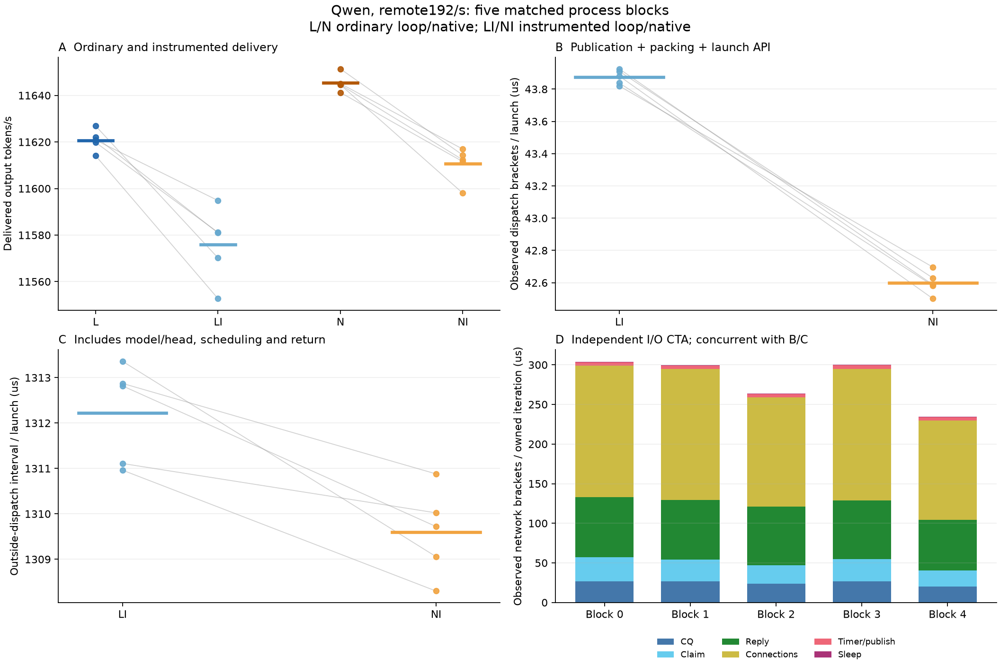

# Current controller-stage timing: complete diagnostic

2026-10-16 UTC. [Plan](plan.md), [plan review](plan-review.md),
[independent result review](result-review.md), [raw full matrix](controller_stage_full/),
[fixed analysis](controller_stage_analysis.py), [CPU archive replay](full_archive_replay.json)
and [cleanup](cleanup.json).

The fixed primary supports a small difference in the instrumented constructor:
loop active dispatch exceeds native by1.276054us/launch
[1.154234,1.397874], nominal paired95%t across five process blocks.
It does not identify an ordinary-serving causal allocation or prove avoidability.
No source/default is selected from this timing diagnostic.

## Completed comparison

Same Qwen FP16 checkpoint, RTX5090, resident upstream-vLLM mixed executor,
16 slots, four frozen prompts and64 output tokens. Five blocks each contain
ordinary loop L/native N and instrumented loop LI/native NI. Each cell schedules
11520 attempts at192/s for60s plus full drain; source-native60s per-I/O timeout.
All230400 attempts succeed,14745600 measured tokens;160 excluded gen1 warmups.
No failure/partial/protocol outcome was hidden or replaced.

All instrumented cells additionally pass existing graph/KV/history and fresh
upstream-attention-metadata replay, full client-token/admit/compute/release joins,
clock/count/input-histogram identities and no graph error/trace overflow.
Ten cells check7372880 exact tokens including80 warmups. This finite trajectory
oracle does not establish eager-HF parity. All1051 frozen-pool disagreements
remain (L197, LI202, N200, NI452); ordinary rows do not have exact full-run fidelity.

All20 source/order/terminal receipts and100 paired rows pass fresh review.
Archived-gzip CPU replay exactly reproduces acquisition stdout with empty stderr.
Artifact-only main checkpoints during gaps change receipt HEAD, not measured
source/binary selection; publication-checkpoint.md retains that distinction.
The initial inline-I/O interpretation was revised before execution: this normal
build has an independent GPU io_network CTA. Its time is concurrent with dispatch.

| Condition | Mean TPS | Mean cell completion P99, ms | Mean cell receive-gap P99, ms | Mean owned CPU, ms/attempt |
|---|---:|---:|---:|---:|
| L | 11620.738676 | 3430.176743 | 4.666489 | 0.638190 |
| N | 11645.377049 | 3299.484309 | 4.330967 | 0.800805 |
| LI | 11575.951651 | 3668.276359 | 4.703870 | 0.632804 |
| NI | 11610.641896 | 3483.660063 | 4.185653 | 0.828999 |

These are means of five process-cell metrics, not pooled percentiles.
All-attempt failures, schedlag, TTFT/TPOT/tails and resource context stay in raw analysis.

| Ordinary L minus N | Paired mean [nominal95%] |
|---|---:|
| TPS | -24.638372 [-30.619771, -18.656973] |
| Completion P99, ms | +130.692434 [+102.014413, +159.370456] |
| Receive-gap P99, ms | +0.335522 [-0.399276, +1.070321] |
| Mean TTFT, ms | +59.857582 [+46.123371, +73.591794] |
| Owned group CPU, ms/attempt | -0.162614 [-0.189810, -0.135418] |

Ordinary CPU is lower, ordinary delivery remains worse. The original
14.72-vs8.36ms receive-gap condition is not reproduced or decomposed here.
At offered12288 output tokens/s versus delivered11621/11645, accumulating
backlog is a plausible amplifier of the small capacity difference; that is an
inference, not a measured allocation of kernel queue/prefill/softirq time.
Current mean completion difference60.163ms is dominated by mean TTFT59.858ms;
means permit this identity, marginal P99 values do not.

## Internal observations and perturbation

Mean active dispatch LI43.875us versus NI42.599us. Descriptive components:
publication/retirement22.601/21.598us, packing16.990/16.764us and launch API
4.284/4.238us. Different graph/input/KV trajectories preclude equal-work
per-kernel attribution. Outside-dispatch interval LI1312.225/NI1309.597us,
difference2.628272[1.132849,4.123696]us; it includes model/head execution,
scheduling, CTA return and unbracketed bookkeeping, not pure model duration.

Instrumentation changes delivery:
| Instrumented minus ordinary | TPS effect [nominal95%] | Completion P99 ms effect [nominal95%] |
|---|---:|---:|
| LI minus L | -44.787025 [-62.578379, -26.995671] | +238.099616 [+142.665793, +333.533439] |
| NI minus N | -34.735153 [-43.955463, -25.514842] | +184.175755 [+131.644056, +236.707453] |

Differential overhead is material beside the ordinary gap. Equal timing source
does not imply equal perturbation. The primary describes an instrumented
association; it cannot be translated into an expected ordinary speedup.

Owned-request network iterations observe connections/reclaim/accept125.065--165.953us
and reply prep/submission63.969--76.039us; sleep approximately0.529--0.530us.
These include polling/mapped-memory stalls and whole-process scopes. No-owned
does not mean idle. Network CTA durations overlap model/dispatch, so never add
them to dispatch/wall latency or label them portions of historical6.36ms.

Five points are process blocks; horizontal bars are means, not confidence
intervals. Network stacked bars are concurrent per-owned-iteration residence;
they are not additive request-path latency. PDF is retained beside PNG.

## Resource and lifecycle scope

Owned TGID/group CPU includes its io-wq workers; workspace cgroup additionally
includes the observer and original processes. Whole-host system/IRQ/softirq and
GPU energy/queue context are retained, but unrelated lab CPU work prevents
exclusive total-server attribution. No full service-total CPU/energy claim.

After all20 clients/warmups/servers/raw archives are recovered, actual owning
Job UID and Pod UID are checked; Job deletion is followed by confirmed absence
of both. Original PIDs1/10909 start ticks8626595/8662925, foreign setup_env.sh,
canonical source and original PVC remain; no BPFusion pins or GPU apps remain.
No replacement Workspace, daemon, service or persistent setting was added.

## Decision

Run valid; narrow instrumented hypothesis supported; ordinary causal allocation
inconclusive. Supporting additional RQ evidence/mechanism boundary; no general
eBPF speed advantage. Keep accepted0074, close this diagnostic without unchanged
reruns or automatic cache/timer sweeps.

A concrete next discriminator is network-control placement: BPF consumes CQEs,
prepares/submits SQEs and retires TCP ownership while GPU retains the exact
resident model/controller. This removes the independent GPU network CTA
without optimizing model math. Current [engineering checks](kernel_owned_build_checks/engineering.md)
establish only ordinary8/16 compilation, identical compiled GPU dispatch and
real verifier-only loading. Attachment/protocol/lifetime/cancellation/reused-model
fidelity and ordinary matched performance remain untested. It is a candidate,
not an adopted generic driver or a performance result. Its separately admitted
comparison must preserve current loop and efficient native controls.
