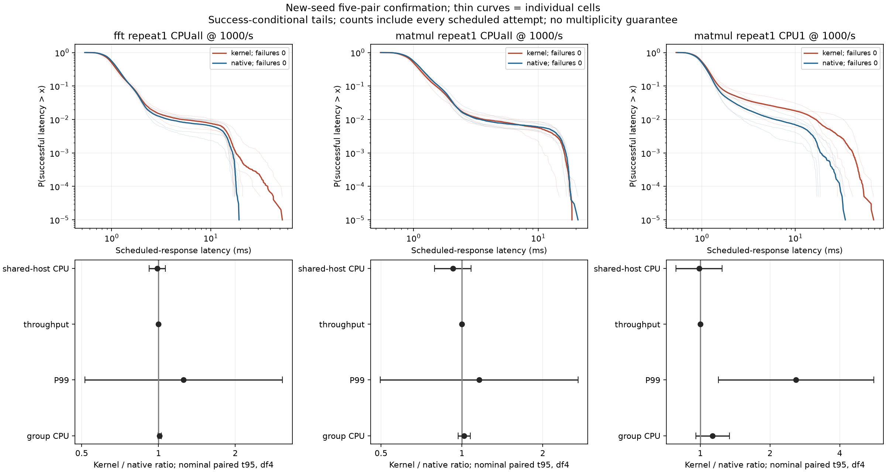
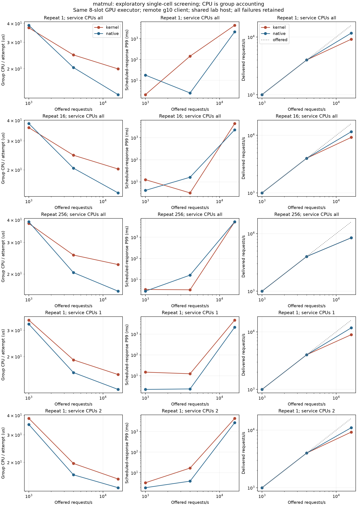
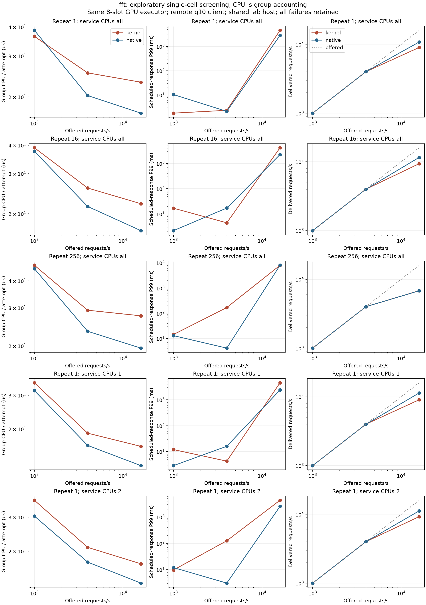

# Small-graph network / CPU result

## Decision

The predeclared local CPU/P99 advantage is **not established** at any of the
three independently confirmed points. Close this bounded performance search
and retain BPFusion as an open-source research prototype with explicit limits.
Do not promote a CPU-saving/small-kernel-low-latency paper claim or restart
model-specific GPU tuning to rescue this result.

All 60 screening cells/2,520,000 measured requests and30 confirmation cells/
600,000 measured requests complete with zero observed request failures.
The original client-timing interruption pair is retained separately with
12,000 correct replies;one cell fails the predeclared timing gate.
A later control-stream outage occurs BEFORE its next measurement and retains
32 warmups but zero measured attempts. No measured confirmation cell is replaced.

## What is controlled

K is the ordinary BPF-owned TCP/connection/CQ/SQ path.
N is efficient C++ timed epoll with the SAME8-slot GPU graph executor.
Both reuse unchanged torch.mm/cuBLAS 8x8 FP32 or torch.fft.fft/cuFFT 32 complex64.
The caller owns independent per-slot graphs/buffers. The graph-dispatch SASS
has376 instruction lines on both paths;no model or library arithmetic is tuned.
The GPU-I/O-loop control is not a userspace io_uring baseline. An additional
userspace io_uring competitor is unnecessary for this bounded question:
the existing efficient native control already contradicts a demonstrated
advantage;no best-possible-userspace ranking is claimed.

Server:original bpfusion-dev Workspace on lab/RTX5090,Linux 7.3-rc3,CUDA toolkit 13,
PyTorch 2.13.0+cu129 and pinned requirements. Remote client:g10/Ryzen 5 3500U,
eight native epoll/timerfd workers/128 persistent connections,Python 3.12.12,
280-byte request/256-byte binary reply. This is inter-node cluster TCP,
not WAN,bare-NIC/GPUDirect or a connection-per-request workload.

The six work variants repeat the same actual library operation1/16/256times.
Host-replay CUDA-event means are approximately GEMM2.42/20.51/317.61us and
FFT4.10/28.71/434.02us. They include host submission gaps and do not measure
pure device-launched-kernel time or the exclusive fraction of network cost.
All outputs are checked against16 finite integer/basis patterns,not universal
numerical accuracy. The served graphs contain no timing/fake-delay nodes.

Screening uses6 s/cell and geometric1000/4000/16,000/s until the fixed saturation
rule. Service affinity1/2 logical CPUs is applied only to its own process/TIDs;
unrestricted allows0..23. It reserves no physical cores and changes no foreign
process,IRQ or global quota. The old CPU2 FFT pair is separated and its whole
configuration reacquired under forward-declared new tags/seeds after a
client-only execution diagnostic. Other54valid cells remain fixed.

[Plan](plan.md),[selection](confirmation_selection.json) and
[sealed screening](screening.md) precede confirmation. Each selected point
gets five counterbalanced20 s process pairs,new seeds and30 s original-arrival
deadlines. Every scheduled request,late/unsent/partial reply,client wait,
failure and full timing record remains available. Scheduled latency includes
waiting for a busy client connection;begin-to-response is separate.

## Fixed confirmation

Ratios are K/N,geometric means of five paired log ratios with nominal
Student-t95(df4). These are selected-cell,small-sample intervals without a
multiplicity guarantee. All three confirmations pass resource/mask/timing
eligibility and have zero failures. Delivered-rate lower intervals exceed.98.

A useful advantage requires CPU upper95<.90 with P99 upper95<=1.05,or P99
upper95<.90 with CPU upper95<=1.05. None passes.

| Confirmation point | Group CPU ratio | Scheduled P99 ratio | Delivered-rate ratio | Decision |
|---|---:|---:|---:|---|
| FFT, unrestricted | 1.011 [0.995, 1.027] | 1.254 [0.514, 3.058] | 1.000 [1.000, 1.000] | No advantage |
| GEMM, unrestricted | 1.019 [0.967, 1.074] | 1.160 [0.497, 2.706] | 1.000 [1.000, 1.000] | No advantage |
| GEMM, one logical CPU | 1.129 [0.956, 1.334] | 2.589 [1.196, 5.607] | 1.000 [1.000, 1.000] | No advantage |

Unrestricted CPU/P99 intervals cross 1;this is neither equivalence nor evidence
that every condition is slower. The one-CPU GEMM P99 ratio2.589
[1.196, 5.607] supports an adverse tail under these matched observation
conditions. Its CPU interval remains inconclusive. All confirmation rates are
near the fixed1,000/s offered ceiling;these do not rank maximum capacity.

Thin CCDFs show individual processes;bold curves pool successful requests for
display only. Statistical replication remains five process pairs,not100000
independent requests per path. Failed attempts would have infinite unknown
tail mass;here all measured attempts complete. PNG and PDF use the same figure.

## Absolute tails and resources

The following are arithmetic means of five per-cell statistics,except the
maximum which is the worst observed request. They are not pooled quantiles
or the denominators used to calculate the paired geometric ratios.

| Point / path | CPU  us/request | Host CPU  ms/request | P50 ms | P95 ms | P99 ms | P99.9 ms | Worst max ms |
|---|---:|---:|---:|---:|---:|---:|---:|
| FFT, unrestricted / kernel | 37.959 | 11.0513 | 0.995 | 1.900 | 6.596 | 19.078 | 62.068 |
| FFT, unrestricted / native | 37.560 | 11.1594 | 1.032 | 1.868 | 5.384 | 15.880 | 19.505 |
| GEMM, unrestricted / kernel | 38.005 | 11.4147 | 0.996 | 1.824 | 4.357 | 15.324 | 19.466 |
| GEMM, unrestricted / native | 37.286 | 12.2379 | 1.034 | 1.900 | 3.680 | 16.480 | 21.232 |
| GEMM, one logical CPU / kernel | 33.515 | 9.7113 | 1.022 | 2.597 | 17.460 | 31.104 | 73.925 |
| GEMM, one logical CPU / native | 29.871 | 9.6749 | 1.001 | 1.850 | 6.583 | 18.790 | 34.714 |

The [complete CSV](confirmation_table.csv) retains P50/P90/P95/P99/P99.9/max,
begin-response,connection wait,client timer lag,CPU/attempt and CPU/success,
throughput and failure counts. Full distributions are in each cell's
latency_ecdf.json.gz;original320-byte request and24-byte timer records remain.

The coarse /proc TGID split explains why removing userspace work is not
removing CPU work. At unrestricted FFT,K averages approximately2.8us user+
35.2us system/request versus N11.3+26.2us. Exact high-resolution group totals
are37.959 versus37.560us. At unrestricted GEMM,the corresponding coarse split
is3.3+34.7 versus11.3+26.2us,with exact totals38.005 versus37.286us.
These tick-based parts are rounded context,not an exclusive attribution of
BPF,TCP,io-wq or IRQ work. They must not be added to other nested scopes.

Whole-host ratios are FFT0.990 [0.920, 1.065],GEMM0.925 [0.791, 1.082],
one-CPU0.988 [0.785, 1.243]. All cross 1. Whole-host totals include foreign tasks
and the observer;adjacent-idle deltas are context,not an attributed net saving.
No total-system CPU reduction is established. TID runtime/runqueue samples,
charged user/system time,visible kernel workers,cgroup CPU/pressure and host
IRQ/softirq remain in [resource_ledger.json](resource_ledger.json).
Namespace-hidden kernel workers are unknown,not zero.

Across the 90 main cells,observer CPU is 1.99..34.01 us/attempt.
Interval sample duration reaches6.971ms. Observation is matched but not free;
it may perturb tails,and no uninstrumented speedup or causal observer effect
is claimed. GPU/NVML is queried only at window boundaries;missing interval
device samples are unavailable. Device energy/clocks/context are raw shared
boundary readings,not exclusively attributed costs.

Maximum observed average owned CPU allocation across these traces is.146
logical CPU. Affinity tests therefore do not establish a strictly CPU-saturated
or exclusive-core experiment;foreign contention and uncharged host work
remain. All recorded cgroup throttled-usec deltas are0. Do not call affinity
selection a guaranteed CPU budget or the server CPU-free.

## Work/load/core boundary

Each of 20 path sweeps first meets the fixed saturation rule at16,000 offered/s,
after4,000/s. The observed load transition is only coarsely bracketed in[4000, 16000];
no exact saturation point or hardware maximum is identified. Queue growth and drain reduce delivered
rates,while failures remain zero under the finite30s deadline.

| Operation | Repetitions | Service CPUs | K delivered/s at 16000 | N delivered/s at 16000 | K/N CPU at4000 |
|---|---:|---|---:|---:|---:|
| matmul | 1 | unrestricted | 9179 | 11740 | 1.213 |
| matmul | 16 | unrestricted | 9217 | 11558 | 1.199 |
| matmul | 256 | unrestricted | 8476 | 8461 | 1.252 |
| matmul | 1 | 1 | 8938 | 11751 | 1.216 |
| matmul | 1 | 2 | 9257 | 11030 | 1.182 |
| fft | 1 | unrestricted | 9004 | 10805 | 1.252 |
| fft | 16 | unrestricted | 9392 | 11591 | 1.205 |
| fft | 256 | unrestricted | 6828 | 6809 | 1.251 |
| fft | 1 | 1 | 9052 | 11370 | 1.158 |
| fft | 1 | 2 | 9251 | 11208 | 1.192 |

At the long-work end,the throughput gap narrows,but group CPU does not acquire
a confirmed advantage. The best provisional low-load CPU/P99 points do not
survive independent confirmation. No **confirmed beneficial crossover** is
located in this bounded grid;that does not rule out untested implementations,
work sizes,rates or hardware.

These are exploratory single-cell curves,not confidence intervals.
Screen-only wins are not the result. Full[screen CSV](screen_table.csv),
[coverage brackets](screen_owner_audit.json) and original timing failures
remain. At overload,large scheduled-response tails mostly reflect accumulating
connection-window backlog;they are not multi-second GPU arithmetic kernels.

## Integrity and lifecycle

Serving/client/observer source text remains3d3878c;intervening commits add
records/docs. Actual receipts match that frozen source. Normal8-slot builds
and14 finite library/lifecycle cases pass2,548 checks before acquisition.
The TCP_NODELAY prerequisite repair retains its adverse native control and
all failed client timing/epoch/capacity prefixes;none is silently pooled.

[Owner independent-code audit](confirmation_owner_audit.json) recomputes raw
outputs with NumPy matmul/DFT,indices/clocks/quantiles,actual masks,group/host
CPU and independently inverts the exact df4 CDF to check paired intervals.
It is sole-thread independent-code recomputation,not independent-person review.
[Canonical replay](analysis_replay.json) recomputes all 92 native-client measured
cells through the original analyzer on OS-temp raw-data symlinks:metrics and
ECDF gzip bytes match,without replacing canonical outputs.
[Lifecycle audit](lifecycle_audit.json) reconciles GPU launches,retirement,
normal stop,empty queues and kernel reply bytes for all measured cells plus
the extra warm-only interrupted service.

The[client execution interruption](client_dispatch_handling.json) and
[control connection incident](control_connection_interruption/incident.md)
remain distinct. The latter has no measured requests. Nodes/Pods/boot/original
sessions stay intact;no reboot or host runtime/permission/credential mutation occurs.
Final actual Job/Pod/key cleanup and original-process checks are recorded in
cleanup.json before this experiment is declared delivered.

## What remains, and what closes

The LLM16/32/official comparison is already complete in
[0080](../../../docs/findings/0080-resident-queue-relief.md).
Its queue relief is shared capacity/batching/KV behavior,not an eBPF speedup.
The historical6.36ms token-gap attribution remains unreproduced/unallocated.

The usable engineering boundary is a module-free transport around reused
GPU graphs,with a separate generation adapter. This fixed64-word example
does not establish a stable arbitrary-kernel plugin,broader shapes/models,
kernel/GPU portability,text/JSON/TLS,long context,multiGPU or production SLOs.
Neither worker removal nor existing GPU-initiated-I/O primitives alone are
a newly demonstrated performance contribution.

Close this bounded research branch with the negative/uncertain/adverse
evidence intact. The daily substantive-progress decision is to finish current
OSS entrypoints,documentation/provenance and real cleanup,not begin another
LLM or GPU-kernel tuning campaign. Current architecture/evaluation consolidate
duplicate chronicles while retaining every finding/raw source. The next new
experiment would require a distinct user objective or concrete reproducer;
this result does not create an endless search backlog.
