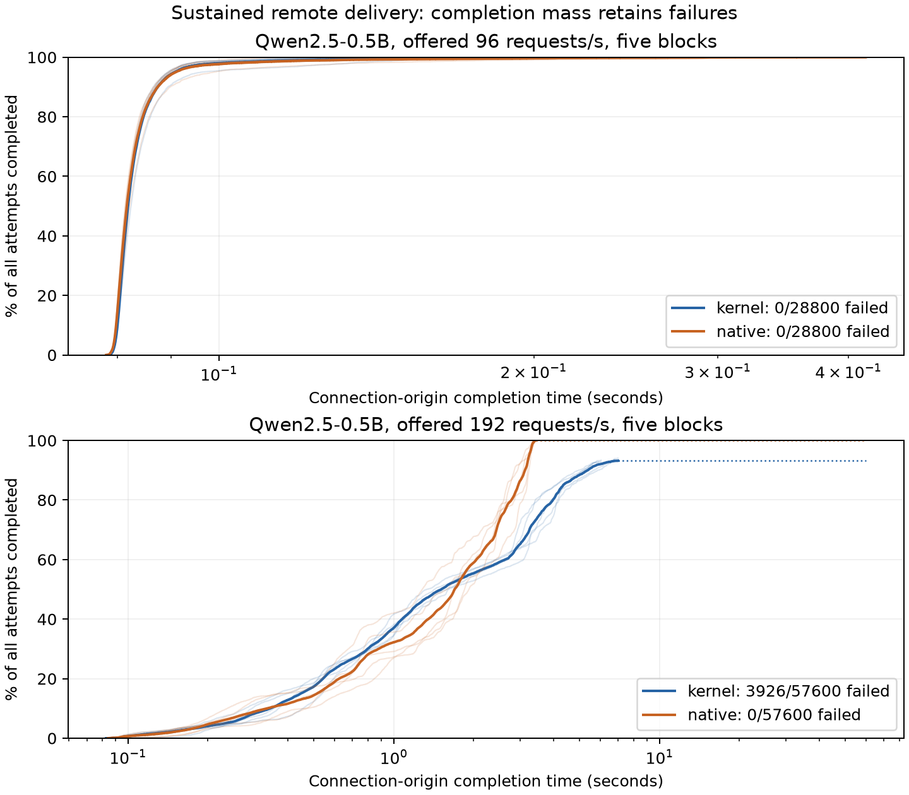
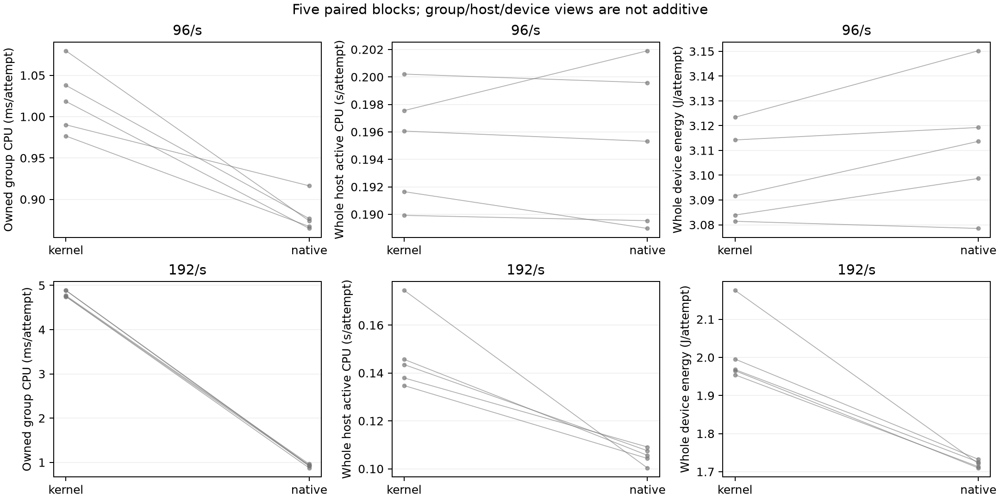

# Sustained remote delivery and resource results

Completed2026-10-16 UTC on the existing lab RTX5090, client on g10.
Source is the adopted mixed NODELAY implementation2c0cf7b; acquisition Git
receipt6a6ac6e contains later records only. Five paired process blocks complete
all20 cells:172800 attempts,168874 successes,3926 failures,10807936 delivered
successful tokens, plus80 excluded warmups. Every failure is a kernel192 read
TimeoutError with zero tokens. Five counts826/815/763/835/687; native192 succeeds
57600/57600. No failed cell removed/replaced. At96 both succeed28800/28800.

## Delivery and observable costs

Means of five process statistics. CompletionP99 is from connect_begin_ns to
final token, conditional on success. At192 kernel6.816% missing completions
prevent interpreting it as all-attemptP99. Throughput/resources include all
attempts and drain.

| Offered/s | Path | Tokens/s | Successful completionP99 ms | Client gapP99 ms | Group CPU ms/attempt | Host active CPU s/attempt | Device J/attempt |
|---|---|---:|---:|---:|---:|---:|---:|
|96|kernel|6134.431|113.933|3.504|1.020526|0.195078|3.098930|
|96|native|6133.913|133.447|3.433|0.879790|0.195062|3.112075|
|192|kernel|7622.919|5901.403|8.533|4.808438|0.147282|2.011795|
|192|native|11637.947|3330.029|4.214|0.923340|0.105390|1.720603|

At192 paired kernel-minus-native nominal t95df4:
successful completionP99 +2571.373[1990.360,3152.386]ms (failure censored);
whole-host active CPU +0.041892[0.018807,0.064978]s/attempt;
group CPU +3.885098[3.792477,3.977719]ms/attempt;
device energy +0.291191[0.177343,0.405040]J/attempt;
throughput -4015.028[-4813.552,-3216.504]token/s.
At96 completion/host contrasts cross zero; group CPU is adverse
+0.140736[0.077826,0.203645]ms/attempt. No equivalence follows.
All14 intervals and per-cell tails, lag, zero-gap fraction, TTFT, TPOT and
scheduled-origin metrics: [analysis.stdout](full/analysis.stdout) and
[analyzer](remote_analysis.py).

CDF denominator includes failures: failed requests never become completed60s
responses. Five faint block curves and pooled curves shown for each path/load.

Nested group/cgroup/host views must never be added. Actual brackets include
remote-control exec and drain; they are not exactly60s. Host/device include
foreign work and observer/control overhead. Group includes io-wq (actual same
TGID); do not count it again. Kernel192 mean group CPU55.393s/bracket, visible
creator system ticks54.762s, versus visible io-wq scheduler runtime0.0143s.
This finite census localizes CPU to creator kernel execution, not a function.
Native192 mean group CPU10.637s. Observer costs roughly4.5–6.1 CPU s/bracket;
this is an instrumented comparison, not exclusive total-service attribution.

[Secondary ledger](resource_details.py) reports idle/active brackets, thread
identities/runtime, observer cost and normalization by successes/tokens with
all numerator work retained. Loaded idle device power is about106W, not an
off-model baseline or exclusive queue cost. Energy includes timeout/drain.
Static GPU register/stack/launch footprint is separate;100% GPU utilization
does not establish SM saturation or per-kernel cost.

## Failure discriminator

Pair3 kernel192 live stats: linked10693 + sockhash insertion failures835 =
11528 including8 warmups; exactly835 read timeouts. General drops zero.
At96 one snapshot has no insertion failures. Pair0 reaches4096 connections;
accepted/closed/received17288 versus admitted/retired/completed16462 leaves826,
matching826 timeouts. Ring drops/overflow zero do not imply every frame admitted.

Sockhash insertion is an observed failure class. The close guard requires the
global pending queue empty before any completed EOF connection closes.
Retention under backlog is a concrete lifetime/capacity hypothesis, not proven
causality. Insertion errno is unknown; E2BIG/EEXIST/other alternatives remain.
Next is a causal ownership discriminator, qualified repair and matched native
retest. Enlarging maps or lowering load is not a demonstrated repair. This
does not allocate the old unreproduced6.36ms tail difference.

## Fidelity, exposures, lifecycle

All successes have valid lengths/vocabulary/protocol.1748/168874 disagree with
the frozen finite reference set, retained; no exact output parity or universal
fidelity claim. No observed-output expansion of that reference.

All10 servers exit0 without outer forced kill and remove owned pins. All30
observer brackets have stable identities and no cgroup OOM/kill delta. A
finite full-window host journal11:16–11:56UTC has no matched EXT4/I/O/OOM/Xid/
BUG/Oops/NVMe/AER error patterns; absence of every fault is not proved.
No owned GPU process remains. Original Coder sessions and unrelated WIP remain.

[Collection notes](collection-notes.md) retain two1.44/3.59ms read-only counter
probes and heavy compression overlapping pair1 kernel96. That exposure remains,
with no favorable replacement;192 primaries are unaffected by that checkpoint.
Foreign workloads stay running. Temporary client Job remains only for immediate
bounded fault diagnosis/retest; delete when that lifecycle closes. Retention is
not cleanup completion, and creates no persistent endpoint/scheduler.

## Replay/review

Raw JSONL are lossless gzip in [full/](full/), alongside commands, source
receipts, stdout/stderr and terminals. Primary durable-archive CPU replay is
byte-identical. Secondary numerical/thread rows are identical, with only the
file field .jsonl versus .jsonl.gz; details.original.stdout retains original.
Plots use private --target dependencies in plot_requirements.txt. First pip
attempt in serving runtime failed because pip absent; system pip then wrote
only private plotting target, without serving/global package mutation.

Replay remote_analysis.py and resource_details.py with the full/ directory as
their single argument. [Independent review](result-review.md) recomputes20 cells
and all intervals. Valid completed observations including serving failures;
current kernel advantage contradicted at192;96 latency/host inconclusive.
Supporting additional RQ/workload-boundary evidence, exclusive cost unresolved.
Current sustained192 reliability unqualified; no eBPF speed/CPU-saving/SLO claim.
