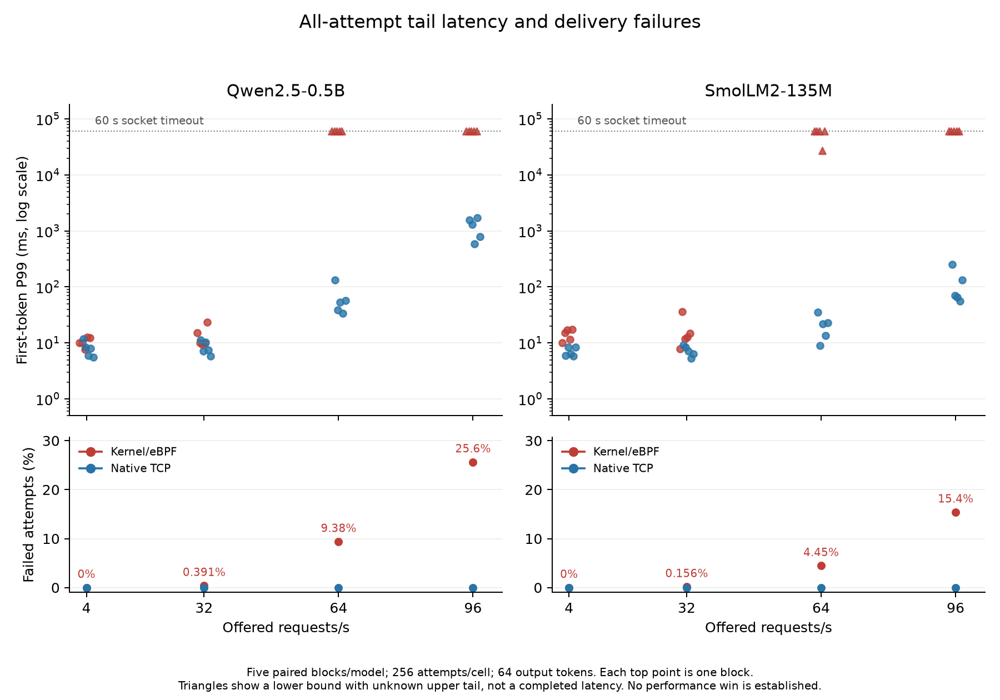

# Offered-load admission and tail latency

2026-10-15 UTC. Complete collection, independently reviewed as valid negative
service evidence. Owned temporary state is removed and copied-data replay
passes. This comparison does not support performance promotion or full-goal
completion.

## Question and comparison

Within the retained complete Linux TCP/HTTP + eBPF/shared queue -> reused
resident real-model GPU execution -> asynchronous kernel TX objective, does
the adaptive loop lower connect-inclusive first-token P99 at64 requests/s
against efficient event-driven native TCP, without winning by failed requests?

There is no formal paper RQ/thesis contract. This is supporting service evidence,
with a mechanism/workload boundary as its potential impact. The single main
competitor uses the same FP16 vLLM graphs, weights, KV precision, eight model
banks and dispatcher. Arithmetic is unchanged. The native constructor waits
for socket/deadline events when idle and uses eventfd for shutdown; it polls
GPU completion at60us only while active/buffered work needs progression.
The kernel candidate inherits0060's repaired adaptive idle wait. Neither
private constructor is selected as production by this collection.

The [reviewed plan and source/raw archive](../../bench/results/offered_load_20261015/)
reuse source-native serving/client and independent upstream graph/KV/history
replay. Rates4/32/64/96 requests/s,256 attempts per cell, five paired process
blocks/model, alternating path and rotating rate order were fixed before
collection. Absolute independent arrivals use pinned vLLM0.31 normalized
cumulative gamma(shape1) schedules; corresponding paths share each schedule.
See [official protocol](https://github.com/vllm-project/vllm/blob/v0.31.0/vllm/benchmarks/serve.py)
and [metric documentation](https://docs.vllm.ai/en/stable/cli/bench/serve/).
This token-ID HTTP adapter is not an official text/JSON endpoint benchmark.

These are actual Python-thread loopback arrivals. The largest cell scheduling-lag
P99 is19.241940ms for Qwen; Smol pair2/kernel/64req/s has107.677338ms.
Configured rates therefore do not mean ideal achieved arrivals. Original
scheduled-origin metrics and all unfavorable cells remain; millisecond tail
differences cannot be attributed exclusively to the server mechanism.

## Complete observations

Full ends09:17:40.729227UTC:20 executors,80 cells,20480 measured attempts and160
checked gen1 warmups. Both model drivers, fixed analyses and wrapper exit0.
The measured attempts request1310720 tokens; successful measured delivery is
1265344 tokens.709 requests fail. Collection success includes those service
failures and must not be described as complete successful delivery.

Each row below contains five blocks,1280 attempts/path. Timing is the mean
of the five per-block P99s of SUCCESSFUL requests, not an unconditional P99.

| Model | Offered req/s | Kernel failures | Native failures | Kernel conditional P99 ms | Native P99 ms |
|---|---:|---:|---:|---:|---:|
| Qwen2.5-0.5B | 4 | 0/1280 | 0/1280 | 10.541 | 7.933 |
| Qwen2.5-0.5B | 32 | 5/1280 | 0/1280 | 12.199 | 8.348 |
| Qwen2.5-0.5B | 64 | 120/1280 | 0/1280 | 10.819 | 63.249 |
| Qwen2.5-0.5B | 96 | 328/1280 | 0/1280 | 10.883 | 1193.619 |
| SmolLM2-135M | 4 | 0/1280 | 0/1280 | 14.208 | 7.004 |
| SmolLM2-135M | 32 | 2/1280 | 0/1280 | 16.141 | 7.233 |
| SmolLM2-135M | 64 | 57/1280 | 0/1280 | 12.680 | 20.532 |
| SmolLM2-135M | 96 | 197/1280 | 0/1280 | 12.680 | 114.600 |

Kernel failures total453/5120 Qwen and256/5120 Smol. Native completes5120/5120
for each model. Every709 failure is a60s TimeoutError with no observed token;
none of its markers occurs in independent model-admission references. Per
kernel executor, failed count equals page drops and llm busy. This extends
the first-block diagnosis across all ten kernel executors.

The eBPF stream verdict calls llm_reserve and drops the valid frame when its
next physical model slot is reserved. It has no pending admission backlog.
Native buffers requests until model slots become available. Thus a lower
successful-request P99 under load can arise from omitting the requests that
would have waited. Ring SQ/CQ dropped/overflow0 does not contradict the
separate model-admission drop counter.

## Primary and all-attempt tails

At64 requests/s the conditional kernel-minus-native P99 difference is
-52.429704ms, nominal paired t95df4[-101.969195,-2.890212], Qwen; and
-7.851692ms[-22.570351,6.866967], Smol. Both primary comparisons have failed
requests in every kernel block. As fixed in the plan, unconditional primary
superiority is censored/inconclusive; the negative conditional Qwen interval
does not establish a service win.

Supplemental tail_censoring.py computes linear-quantile identification bounds
from every attempt. Unknown first-token/completion times are lower-bounded by
the actual no-token/incomplete observation duration and have no established
finite upper bound. It does not assign a timeout an exact completed latency,
change the primary metric or provide a confidence interval.

For Qwen at64 and96 requests/s, every block's all-attempt P95 and P99 lower
bound exceeds60s. For Smol, P99 has unknown upper tail in every64/96 block;
at64 one block's linear P99 lower bound is27.035s, and the other four exceed60s.
At96 every Smol block's P95/P99 lower bound exceeds60s. Sparse 256-attempt
cells do not establish stable P99.9 or a steady-state capacity bound.

Each top point is one process block; triangles are right-censored lower
bounds with unknown upper tails. The lower panel includes every attempt.
Rendering used a post-collection matplotlib installation with no changes to
existing measured-runtime packages; plot_dependency.json records that scope.

The no-failure4req/s condition is also not a general kernel win. Smol's
kernel-minus-native P99 difference is+7.204810ms[3.875944,10.533677], adverse in
all five blocks. Qwen+2.608249ms[-1.441127,6.657625] is inconclusive.
All secondary timing, throughput and CPU rows remain in fixed analysis,
including unfavorable rows and outliers.

At64req/s, achieved successful output tokens/s is232.297/4011.500 kernel/native
Qwen and248.325/4033.754 Smol. Those cell windows include full timeout drains;
these are delivered-window outcomes, not model-only saturation capacity.
Process CPU ms/attempt is2.105287/.677386 Qwen and2.436285/.700616 Smol. Different
success fractions prevent equal-work attribution, and this excludes portions
of RX/softirq/io-wq. It is not total service CPU or energy.0060's idle CPU
savings do not transfer into a general CPU or latency claim for this workload.

## Correctness, qualification and host scope

Before full, existing protocol, lifecycle, idle/helper-stop qualification and
real offered-load preflight completed. Protocol qualification covers2488
requests/88896 checked tokens across both model/path cases, with259 intended
rejections and5000 empty connections per case. Four32-action lifecycle cases
retain pre-observation complete/prefix controls; canceled/partial responses
are not all complete numerical-output checks. The Qwen real preflight has64
measured attempts4096 tokens plus16 warmups and no failed measured attempt.

Successful full outputs match independent graph/KV/history replay, with no
model graph error or actual BF_TRACE history overflow. The128-entry ring
reply diagnostic may overflow during a large full executor; it is separate
from the complete GPU trace and from SQ/CQ/model-admission drop counters.

Sparse host receipts retain the same boot and56 selected historical warning
lines. One Qwen observation is in a measurement/timeout-drain phase; the Smol
observation at08:58:01.879603UTC is within pair2/rate4 measurement. After receipt
09:18:57.831632UTC is77.102405s after full terminal and has no GPU application.
These samples do not establish continuous GPU isolation, fault-free hosting
or exclusive bottleneck attribution.

## Decision and remaining work

The [independent result review](../../bench/results/offered_load_20261015/result-review.md)
confirms complete valid collection and a failed complete-delivery requirement;
the numerical unconditional primary remains censored/inconclusive. The review
was completed before cleanup and does not certify later operational steps.

The [restoration receipt](../../bench/results/offered_load_20261015/final_restoration.json)
records removal of only the owned old experiment temporary directory, unchanged
eight preserved files, base packages and Coder process start times, no module or
pins, and unchanged production source. All seven CPU analyses reproduce saved
stdout byte for byte from the archive after temporary-directory removal; see
[final replay](../../bench/results/offered_load_20261015/final_replay.json).
The separate unbuilt candidate directory is preserved. This record is published
on main with the complete evidence; publication is not a performance claim.

The collection does not justify selecting these private constructors or
claiming an eBPF P99/throughput advantage. Preserve the original production
source and the complete negative evidence. The next implementation target is
admission waiting/ownership rather than model arithmetic: a proposed private
FIFO backlog has a separately reviewed plan and is not yet built or tested.
A finite backlog is not complete TCP backpressure and must retain its overload
failure boundary. The full user objective remains active.
