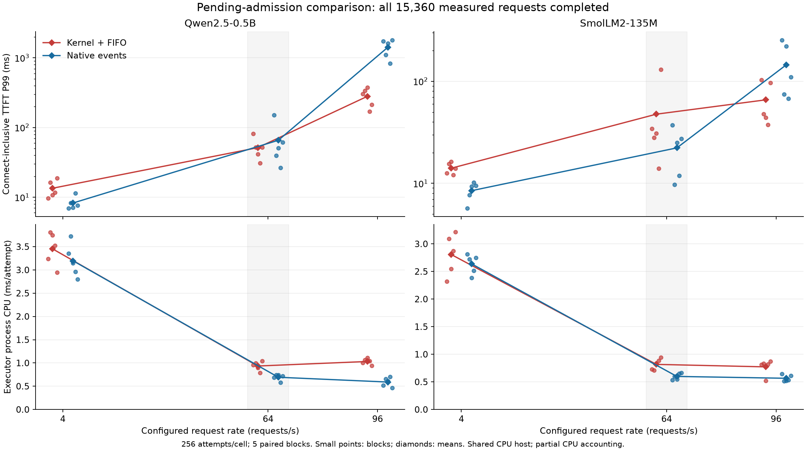

# Pending admission: complete delivery and mixed service tails

2026-10-15 UTC. Complete collection and independent result review. Both
paths deliver every measured request; the predeclared P99 superiority remains
inconclusive. A secondary Qwen high-load tail benefit comes with worse median
latency and higher executor CPU. Production selection and final temporary
runtime cleanup remain separate, unfinished work.

## Question and mechanism

Within the retained Linux TCP/HTTP -> eBPF/shared queue -> reused resident
GPU model -> asynchronous kernel TCP TX objective, can finite pending admission
avoid the previously observed drops and lower connect-inclusive first-token
P99 at 64 requests/s against event-driven native TCP?

This is supporting evidence about a mechanism and workload, not a formal paper
RQ or novelty proof. Both paths reuse identical FP16 vLLM graphs, weights,
KV precision, eight model banks and dispatcher. No model arithmetic changes.
The native competitor uses epoll/deadline readiness while idle, eventfd shutdown,
and active completion progression. It is an engaged same-compute alternative.

The candidate places valid requests into a FIFO BPF pending map. A single
existing kernel loop waits for a physical model slot before publication.
Queue capacity is discovered from existing somaxconn (4096); it is finite.
Queue overflow still drops requests: this is not complete TCP backpressure
or a guarantee for arbitrary overload. Normal EOF recycling conservatively
waits for the global backlog; reset/stop cancellation is separately qualified.

The canonical page gains eight tail bytes, from 17,336 to 17,344; existing
field offsets and the 20,480-byte mapped allocation stay unchanged. The
exact-size-checking module must be rebuilt for this page. Source snapshots
and actual build bindings are retained in the
[complete archive](../../bench/results/pending_admission_20261015/).

## Protocol and complete collection

The reviewed plan fixes rates 4/64/96 requests/s, 256 attempts per cell,
five paired process blocks/model, four prompts and 64 generated tokens.
Path order alternates, rate order rotates, and both paths share each absolute
arrival schedule. The primary is connect-begin to first-token P99 at 64/s,
with failed requests censoring superiority. Actual client-thread release lag,
scheduled-origin timing and every adverse block remain visible.

Full collection ends at 11:21:07.991049 UTC: 20 executors, 60 cells,
15,360 measured attempts, all 15,360 successful, 983,040 delivered tokens
and 160 additional checked gen1 warmups. Both model drivers, analyses and
wrapper exit zero. Each model/path/rate has 1,280 measured attempts.

The following values are means of five per-block P99s, not pooled percentiles.
All rows have zero failures on either path. Each entry is kernel / native.

| Model | Offered requests/s | First-token P99 ms | Complete-response P99 ms | Delivered tokens/s |
|---|---:|---:|---:|---:|
| Qwen2.5-0.5B | 4 | 13.440 / 8.253 | 95.421 / 87.558 | 255.658 / 255.675 |
| Qwen2.5-0.5B | 64 | 51.446 / 65.621 | 138.477 / 150.994 | 4008.457 / 4012.723 |
| Qwen2.5-0.5B | 96 | 280.139 / 1418.437 | 362.191 / 1503.890 | 5546.843 / 5611.480 |
| SmolLM2-135M | 4 | 14.067 / 8.481 | 77.708 / 73.627 | 255.789 / 255.795 |
| SmolLM2-135M | 64 | 47.667 / 22.275 | 128.913 / 86.961 | 4031.369 / 4035.325 |
| SmolLM2-135M | 96 | 65.889 / 145.327 | 132.182 / 212.338 | 5989.351 / 5965.383 |

### Primary uncertainty and secondary tradeoffs

Differences below are kernel minus native, nominal paired t95 with df4.

| Primary at 64 requests/s | First-token P99 difference ms | t95 interval ms |
|---|---:|---:|
| Qwen | -14.175554 | [-53.893458, +25.542351] |
| Smol | +25.391696 | [-29.697391, +80.480783] |

Both intervals cross zero: superiority is inconclusive, and equivalence
is not established. Unlike the previous dropping-constructor comparison,
these primary results are not censored by failed requests.

At secondary Qwen/96, all five paired P99 effects favor the candidate:
-1138.298 ms [-1647.711, -628.885]. Scheduled-origin TTFT and completion
P99 show similar improvements. However, mean block-median TTFT is
134.386 / 30.120 ms kernel/native; median completion is 220.757 / 116.754 ms.
The candidate has a better extreme tail and worse median in this condition.
Admission policies and batch trajectories differ, so this cannot isolate
syscall removal as the cause.

Smol/96 P99 difference is -79.438 ms [-175.748, +16.872], inconclusive.
Low-load Smol/4 first-token P99 is worse: +5.586 ms [+2.538, +8.634].
At 4/s completion P99 is worse for both models. None of the delivered
throughput comparisons establishes an advantage; 96/s windows include drain
time and are not steady-state capacity estimates.

Executor process CPU per attempt is higher at both 64 and 96/s:

| Model/rate | CPU difference ms/attempt | t95 interval |
|---|---:|---:|
| Qwen/64 | +0.241695 | [+0.161519, +0.321871] |
| Qwen/96 | +0.441910 | [+0.356092, +0.527729] |
| Smol/64 | +0.218247 | [+0.130915, +0.305580] |
| Smol/96 | +0.206631 | [+0.047593, +0.365669] |

This excludes parts of RX/softirq/io-wq and client CPU. It is not total
service CPU or energy. Earlier idle CPU savings do not transfer into
a CPU saving for this stronger offered-load comparison.

All block points and adverse outliers are retained; the shaded 64/s condition
is the fixed primary. Portable plot source, PDF and data are beside the image.
Matplotlib was installed only after measurement, with no existing measured
package versions changed; plot_dependency.json records the scope.

## Correctness and operational scope

Ten qualification commands complete before full: six protocol executors cover
3804 protocol outcomes and 137952 independently replayed model tokens,
including intentional rejection cases; module compatibility, idle/helper-stop
and four lifecycle cases also pass. Fragmentation, batches 1-8, reuse,
pipeline, half-close and binary/HTTP framing are exercised. Non-loop module
compatibility retains its separate scope.

Loop lifecycle tests retain 16 queued requests before backlog RST and
56 before stop, beyond the eight physical slots. All 78 connections close,
physical reservations clear, and the 56 unadmitted stop requests remain
explicit cancellations until map destruction. Partial/canceled observations
are not claimed as complete numerical deliveries.

Every full saved client token, independently replayed model history, admission
and physical-slot release agrees. Full replay covers 15,520 histories and
983,200 tokens including warmups, with no actual GPU history overflow.
The bounded 128-entry reply diagnostic overflows separately; it is not the
GPU correctness history. Post-ready protocol traces observe no userspace
accept4/recvfrom/sendmsg on the qualified loop path.

Initial missing kernel-header-link build failure and the synthetic fixture's
pre-DONE final-token timeout remain archived. Supported KDIR rebinding and
the fixture's correct prefix -> DONE -> final-token sequence repair them
before qualification/preflight. No measured cell, timeout, model oracle,
arrival schedule or primary metric was replaced.

This is a shared-host loopback comparison. A pre-full sample records about
21 process CPU cores on a 24-core host, principally another Workspace.
Actual client scheduling is imperfect: the largest Smol kernel/64 block
scheduling-lag P99 is 218.468 ms and maximum individual lag is 245.824 ms.
That adverse block remains included. Sparse GPU ownership/host snapshots
do not establish continuous exclusivity or explain every tail excursion.
Five paired blocks and 256 attempts/cell support neither precise P99.9 nor
a stationary population-tail estimate; secondary intervals are nominal,
without multiplicity correction.

## Decision

The [independent result review](../../bench/results/pending_admission_20261015/result-review.md)
accepts valid complete collection, finite-workload admission correctness and
inconclusive primary superiority. It retains the secondary Qwen tail benefit
and its median/CPU costs. Seven CPU analyses reproduce saved stdout byte for
byte; CPU replay checks saved evidence, not a second GPU numerical run.

The old [709 kernel failures](0061-offered-load-admission.md) remain prior
failure evidence. Hosting and rate matrices differ, so old versus new counts
are not a concurrently matched causal effect estimate.

Preserve the candidate as an admission repair with bounded evidence, not a
general eBPF latency/throughput/CPU win. At this publication step it is still
a private-source candidate: ordinary application source/defaults are unchanged.
Production integration and final owned-runtime restoration remain unfinished;
the original Workspace, private runtime needed for that work, and unowned WIP
are preserved. The full retained project objective remains active.
