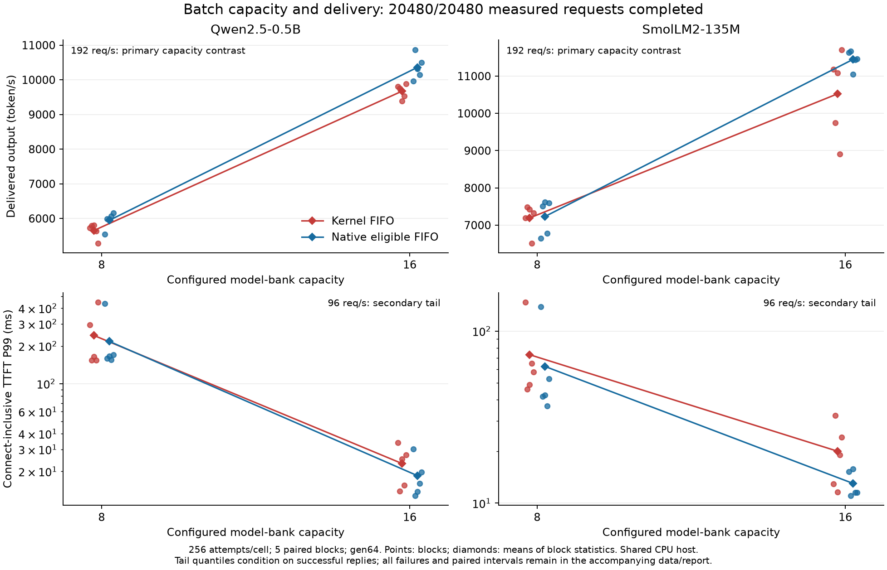

# Sixteen model banks improve delivery; same-width eBPF superiority is unproven

The completed traced comparison supports increasing this constructor's model-bank
capacity from eight to sixteen under the tested offered load. Kernel-path output
throughput at192 requests/s rises from5653 to9673 token/s for Qwen2.5-0.5B
and7190 to10525 for SmolLM2-135M. Both primary paired intervals are positive,
with no failed measured request. This is a capacity intervention with reused
computation, not an intrinsic eBPF speedup. The stronger same-width native16
competitor wins the Qwen192/s delivery comparison; Smol transport differences
are inconclusive.

Collection, independent result review and restoration are complete.
The [single fresh review](../../bench/results/batch_capacity_20261015/result-review.md)
finds the finite traced run valid and both primary capacity hypotheses supported.
The [restoration record](../../bench/results/batch_capacity_20261015/final_restoration.json)
confirms owned temporary state is removed and preserved state is unchanged.
No ordinary source or production default is selected by this private experiment.

## Question and intervention

The retained objective is Linux TCP/HTTP + eBPF/sockmap -> shared queue ->
resident reused real-model GPU execution -> asynchronous kernel TCP TX without
a steady userspace request worker, improving latency and throughput. This is
supporting evidence within that question; no new formal paper RQ is introduced.

Finding0063's saved Qwen96/s histories frequently execute at the eight-bank
ceiling. Those logical counts motivate a direct capacity intervention without
proving time occupancy or an exclusive bottleneck. The
[admitted plan and single review discussion](../../bench/results/batch_capacity_20261015/)
compare kernel8/native8/kernel16/native16, with the same eligible-frame FIFO
native admission and reused upstream optimized FP16 computation. Native16 is
the main competing mechanism; eight-bank paths are capacity controls.

The semantic capacity snapshot difference is BF_LLM_SLOTS8->16, with matching
Makefile/header/BPF/loader/GPU bindings. Model arithmetic is unchanged.
Bank/KV allocation, shared-page ABI, batching trajectories and resource use can
differ with capacity: this is not identical kernel-sequence execution.
The unchanged legacy/module paths are not qualified for the private16 ABI.
BF_TRACE is enabled equally on all measured conditions.

Two models, five paired process blocks, gen64, rates96/192 and256 scheduled
attempts/cell fix40executors/80cells. A Williams condition order balances the
first four blocks; the fifth repeats block0. Both rates rotate, and conditions
within each block share normalized gamma(shape1) arrival schedules. No outcome
causes a changed oracle, timeout, workload, metric, replacement or exclusion.

## Complete execution and numerical evidence

The actual full wrapper ends2026-10-15T15:22:39.023596UTC with both model
drivers and fixed analyses exit0. All20,480 measured attempts succeed and deliver
1,310,720 measured tokens, plus320 checked gen1 warmups. All40executors pass
independent upstream graph/head/KV/history replay and wire-token agreement.
Queue, reservation, connection and ring accounting drain at normal stop.

Before full collection, all four16-bank protocol executors pass5136 outcomes,
including2060 intended rejects, with188800 independently replayed tokens.
These are not5136 successful inference responses. Four bounded ordinary
lifecycle cases pass their recorded complete/prefix/cancellation checks;
unobserved canceled frames are not complete numerical responses.
The finite historical output pool is not a universal ordinary-output oracle.

All five archived CPU analyses (real preflight, two protocols, two full models)
reproduce saved stdout byte for byte. A separate stdlib-inclusive-quantile
calculation from raw arrival timestamps matches640 P95/P99 values across both
models. Complete metric rows, raw histories, fixed sources and commands are in
the [archive](../../bench/results/batch_capacity_20261015/).

## Primary throughput and capacity interpretation

Values are means of five block statistics. Effects are kernel16 minus kernel8,
with nominal paired t95df4 intervals; these are finite delivered-window
throughputs, not steady-state saturation capacities.

| Model | Kernel8 token/s | Kernel16 token/s | Signed difference [t95] |
|---|---:|---:|---:|
| Qwen2.5-0.5B |5653.495|9672.702|+4019.207 [3554.685,4483.729]|
| SmolLM2-135M |7190.349|10524.759|+3334.411 [2143.702,4525.120]|

Ratios of block means increase71.1% and46.4%, respectively. Native16 also gains
over native8: +4413.412 [4057.039,4769.784] Qwen and
+4218.648 [3453.942,4983.354] Smol token/s. Thus the improvement is shared by
both serving mechanisms and supports a tested constructor-capacity boundary.
It does not isolate the exact split between batching, queueing, resource use
and scheduling, nor prove that removing userspace caused the gain.

## Tail latency and strongest same-width comparison

All values below are means of block quantiles in milliseconds, not pooled
quantiles. The192/s table retains both controls and the strongest competitor.

| Model | Path | Banks | Output token/s | TTFT P99 | Completion P99 |
|---|---|---:|---:|---:|---:|
| Qwen |Kernel|8|5653.495|1486.048|1564.246|
| Qwen |Native FIFO|8|5946.441|1361.071|1441.535|
| Qwen |Kernel|16|9672.702|297.181|383.272|
| Qwen |Native FIFO|16|10359.853|200.338|288.349|
| Smol |Kernel|8|7190.349|890.705|953.925|
| Smol |Native FIFO|8|7229.893|878.424|944.028|
| Smol |Kernel|16|10524.759|155.250|271.669|
| Smol |Native FIFO|16|11448.541|62.696|139.318|

Kernel16-minus-kernel8 TTFT P99 at192/s is
-1188.867 [-1341.720,-1036.015]ms Qwen and
-735.456 [-798.975,-671.936]ms Smol. Capacity relief therefore improves
this secondary high-load tail in both tested models.

However, kernel16-minus-native16 at192/s is adverse for Qwen:
throughput-687.151 [-1145.186,-229.115]token/s,
TTFT P99+96.843 [17.381,176.306]ms and
completion P99+94.923 [6.911,182.935]ms.
Smol throughput-923.782 [-2453.508,605.945]token/s,
TTFT P99+92.554 [-123.651,308.758]ms and
completion P99+132.350 [-92.290,356.990]ms remain inconclusive.
There is no established same-width transport superiority.

Capacity relief does not improve every latency component. At192/s, the mean
client-observed TPOT worsens from1.346190 to1.514645ms for
Qwen and from1.046937 to1.332702ms for Smol on the kernel
path. Native16 means are1.450007/1.254242ms Qwen/Smol.
These are means of per-cell request TPOT,not isolated GPU-step timings or
paired significance claims. Reduced queueing and first-token tails must not
be presented as universal token-latency improvement.

At96/s, TTFT P99 is:

| Model | Kernel8 | Native8 | Kernel16 | Native16 |
|---|---:|---:|---:|---:|
| Qwen |243.150|218.014|23.104|18.481|
| Smol |73.026|62.394|20.031|13.020|

The kernel-capacity difference is-220.046 [-373.904,-66.188]ms Qwen and
-52.994 [-111.435,5.446]ms Smol. The latter crosses zero despite lower means.
Both96/s same-width16 TTFT and completion P99 intervals cross zero, as do
same-width16 throughput contrasts. All P50/P95/P99, scheduled-origin tails,
TPOT, failures, process CPU, individual blocks and paired effects remain in
the full analyses and figure data.

The [PDF](../../bench/results/batch_capacity_20261015/batch_capacity_results.pdf),
[plot source](../../bench/results/batch_capacity_20261015/plot_results.py)
and [all plotted and unplotted metrics](../../bench/results/batch_capacity_20261015/batch_capacity_results.data.json)
retain every block, including adverse outliers.

## CPU, host exposure and scope

At192/s, kernel16/native16 measured executor CPU is0.846591/0.452892ms
per attempt for Qwen and0.564381/0.396877 for Smol. Earlier idle-process CPU
savings do not imply active-service or total-host CPU savings. This bracket
excludes client work and some RX/softirq/io-wq/kernel cost; it is not energy.

The shared CPU host has substantial scheduling-lag outliers. Smol kernel16
pair1/192 has scheduling-lag P99 of288.425ms; its connect-inclusive TTFT P99
is72.934ms while scheduled-origin TTFT P99 is312.474ms. All such observations
remain included. Client lag, batching and recv coalescing prevent interpreting
client token gaps as isolated GPU execution or the transport effect as syscalls only.

Sparse host records explicitly identify their phases. The Qwen short sample is
4.167s after its preceding measured cell; the Smol short sample falls inside one
192/s kernel8 cell. Both report only observed application ownership at those
times. The post-full snapshot is92.803s after terminal, same boot, no reported
GPU app and the same56 selected historical fault lines as before.
None establishes continuous isolation or absence of all interference.
Matplotlib dependencies are added only after measurement terminal, without
changing any existing measured package version.

With256 attempts/cell and five blocks, P99 depends on few order statistics.
Nominal paired intervals and many secondary comparisons do not provide precise
population tails, P99.9, production SLO guarantees or equivalence.
A positive BF_TRACE capacity result does not establish ordinary untraced
performance, arbitrary backend support or a selected sixteen-bank default.

## Decision boundary

The tested primary capacity hypothesis is supported; this is supporting
mechanism/workload evidence, not general eBPF superiority. The active goal
still requires a useful reusable serving result with honest matched evidence.
Any ordinary adoption decision must address its computation/ABI bindings and
measure the ordinary serving behavior rather than transferring traced timing.
Do not repeat this unchanged capacity matrix or attribute native-capacity gains
to the eBPF path. Close this matrix after the single valid result review.
Owned runtime/build/dependencies are removed after no remaining process,pin,
module,cwd,mapping or open-file user was found. Five copied CPU analyses still
match bytewise after removal. Eight original file fingerprints,the two Coder
process identities,base package versions and application sources remain unchanged.
The larger serving/performance objective remains active; this finite traced
capacity result does not complete ordinary adoption or general superiority.
