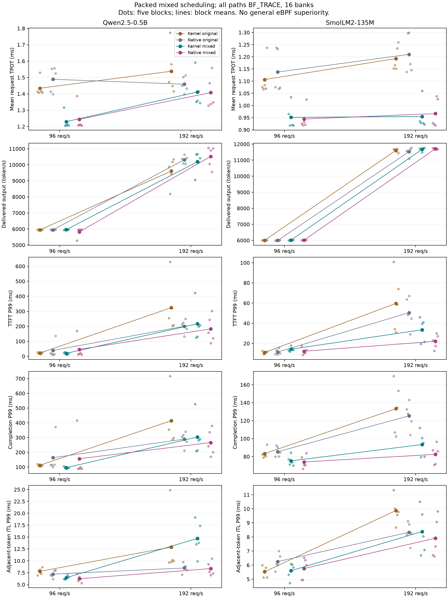

# Mixed prefill/decode improves generation time; eBPF superiority is unproven

The completed equally BF_TRACE comparison supports packing newly admitted
prefills and active decodes into one reused upstream model invocation.
At96 requests/s,the kernel path's mean request TPOT improves14.25% for
Qwen2.5-0.5B and14.04% for SmolLM2-135M. Native also benefits.
The [single fresh independent review](../../bench/results/mixed_batching_20261015/result-review.md)
finds the finite run valid and complete,with both primary hypotheses supported.
This is supporting scheduler evidence,not a model-kernel invention or an
established eBPF performance advantage.

## Mechanism and fair comparison

The previous dispatcher serves only prefills whenever new prefills exist,
withholding active decodes. The candidate packs real prefill inputs and one
token per active decode contiguously,retaining upstream vLLM operators,head,
sampling and KV allocation. Arithmetic source is unchanged;batch shapes,
metadata and schedules differ. The upstream mixed descriptor supplies graphs;
no attention support flag or arithmetic kernel is patched.

Original-kernel/original-native/mixed-kernel/mixed-native all use16 banks.
Same-mixed native is the strongest competitor;original conditions are controls.
Both models use FP16,vLLM0.31.0,gen64,rates96/192,256 scheduled attempts/cell,
five paired process blocks and identical per-block normalized gamma arrivals.
All paths enable BF_TRACE;these are not ordinary untraced timings.

## Completion and correctness

Full execution ends2026-10-15T19:09:42.442525UTC. All40 executors/80 cells
finish20,480 measured attempts with0 failures and1,310,720 output tokens,
plus320 gen1 warmups. Preflight completes128 measured requests/8,192 tokens
plus32 warmups. Four new protocol executors complete5,136 outcomes,including
2,060 intended rejections,and independently verify188,800 valid output tokens.

Actual batches1..16,fragmentation,ring wrap,mixed generation lengths,pipeline
half-close,rejection recovery and shutdown after completed work pass.
Every mixed executor passes graph/history replay and a separate source-native
reconstruction of attention metadata with exact output-token agreement.
Queue/ring/release accounting drains without recorded overflows/reservations.
The reviewer independently recomputes all80 cells and effects,and reruns both
full and both protocol analyzers byte-identically.

Unchanged transport reset/in-flight-stop evidence comes from prior integration.
The mixed constructor's partial-output cancellation,default8 and ordinary
untraced adoption remain unqualified here.

## Primary result

Means are over five block statistics. Effects are mixed-kernel minus
original-kernel at96/s,with nominal paired t95 df4 intervals.

| Model | Original TPOT ms | Mixed TPOT ms | Difference [t95] ms |
|---|---:|---:|---:|
| Qwen |1.434478|1.230084|-0.204394 [-0.303490,-0.105298]|
| Smol |1.106505|0.951180|-0.155325 [-0.279908,-0.030742]|

Native means also improve:Qwen1.488997->1.244486ms,Smol1.137332->0.944331ms.
This common gain cannot be attributed to eBPF.

## Throughput and tails

The192/s values below are means of block metrics,not pooled quantiles.

| Model | Path/scheduler | token/s | TTFT P99 ms | Completion P99 ms | ITL P99 ms |
|---|---|---:|---:|---:|---:|
| Qwen |Kernel original|9606.590|323.825|414.381|12.888|
| Qwen |Native original|10318.045|200.150|289.486|8.494|
| Qwen |Kernel mixed|10191.299|216.897|303.612|14.723|
| Qwen |Native mixed|10517.336|182.494|266.003|8.363|
| Smol |Kernel original|11609.950|59.690|133.382|9.876|
| Smol |Native original|11529.709|50.490|125.389|8.333|
| Smol |Kernel mixed|11676.171|33.556|93.413|8.385|
| Smol |Native mixed|11708.232|22.091|82.497|7.910|

All planned same-mixed TPOT,throughput,TTFT P99 and completion P99 intervals
cross zero;that proves neither superiority nor equivalence. Qwen192/s mixed
kernel ITL P99 is worse than mixed-native by6.359661[2.113625,10.605697]ms.
A better average TPOT therefore does not imply smoother tail token delivery.

At192/s,mixed-kernel/native process CPU is0.709861/0.447755ms per attempt
for Qwen and0.466722/0.361802 for Smol. These partial process brackets exclude
some kernel/client work and are not total service CPU or energy. Active-load
results do not support a blanket CPU-saving claim.

## Limits and decision

The [archive](../../bench/results/mixed_batching_20261015/) retains raw requests,
scheduled-origin tails,client lag,coalesced/zero ITLs,all paired effects,
executed sources and preparation history. Shared-host exposure was not observed
continuously. Sparse ownership snapshots do not establish isolation or absence
of faults;lag outliers remain. P99 has few order statistics per256-attempt cell,
and neither P99.9 nor production SLOs are proven.

Retain the private candidate;production defaults remain8 with the previously
qualified scheduler. Ordinary adoption requires default8,untraced fidelity/
lifecycle and partial-output-stop qualification. Close this unchanged matrix.
The higher-value remaining questions concern complete-service resource cost,
remote offered-load tails and practical reusable-backend adoption.

Owned temporary runtime/build dependencies are removed after no remaining process,
mapping,fd or cwd user was found. Five archive analyses still reproduce saved
stdout byte-identically after removal. Eight preserved build files,Coder process
start identities and base package versions remain unchanged;see the
[restoration record](../../bench/results/mixed_batching_20261015/final_restoration.json).
