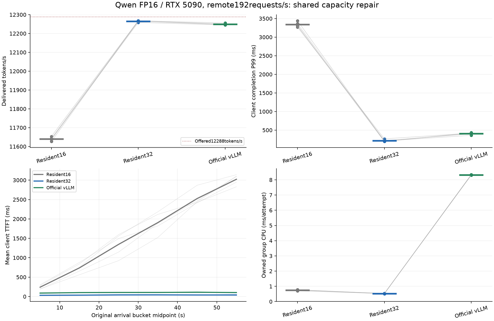

# 0080: relieve the shared resident queue with a qualified32-bank profile

2026-10-17 UTC. [Complete experiment](../../bench/results/resident_queue_relief_20261017/result.md)
links the prior-data mechanism diagnosis, preregistered plan, ordinary builds,
two-model numerical/protocol/cancellation qualification, single diagnostic,
full15cells/raw workers/resources, recomputation and owner-only audit.
No delegated or independent-person review is claimed.

At the same remote Qwen192requests/s60s load,16-bank completionP99 is3337.271ms,
32-bank217.356ms and contemporaneous official optimized vLLM405.869ms.
All172800 measured requests complete,0 failures. Fixed32-minus16 primary:
-3119.915[-3227.115,-3012.715]ms; throughput11639.616->12265.069tokens/s.
Official12249.355tokens/s is near the same12288offered ceiling; no maximum
throughput ranking follows. The fivefold tail gap was sustained queue growth
from insufficient common active capacity, not fivefold slower model arithmetic.

The normal [32-bank mixed profile](../getting-started.md#qualified-32-bank-mixed-profile)
uses existing Make capacity with matching BPF/loader/GPU/page layouts.
Two-model finite exact dual replay covers batches1..32 and ordinary reset/stop.
Global default8 remains for legacy layouts. Capture/KV/batching/admission
change together; no isolated KV/chunked-prefill cause or new model kernel.

Adverse evidence remains:meanTPOT+0.033308[0.014804,0.051811]ms;
receivegapP99+1.494[-2.196,5.185]ms,inconclusive. Finite trajectory flags
952/633/739 are not excluded. Device-wide energy versus official is
+0.335718[0.322754,0.348683]J/attempt. Group CPU falls,shared host CPU
32-minus16 remains inconclusive. Client lag/protocol coalescing prevent GPU
ITL attribution. The old6.36ms kernel/native gap remains unallocated.

This supports a common capacity repair and closes the motivating local LLM gap.
It is not an eBPF advantage:the full32-bank arm uses native epoll.
Per user decision,LLM speed competition is closed; the next bounded experiment
tests small cuBLAS/cuFFT requests with the same executor on both transports.
